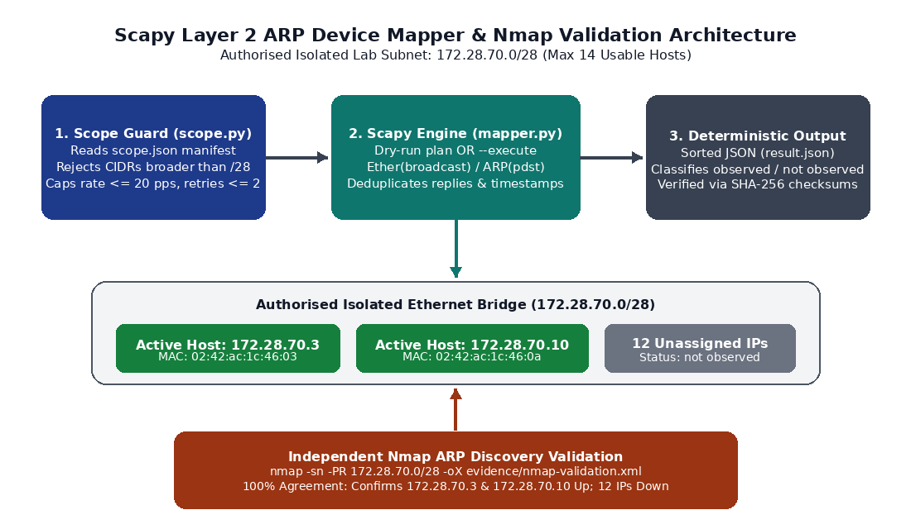

# Network Reconnaissance & Nmap Validation Tool using Scapy

## 1. Objective

The objective of this project was to design, build, and empirically validate a scope-enforced **Layer 2 ARP Device Mapper** in Python using **Scapy**, and cross-validate its host discovery results against **Nmap** (`nmap -sn -PR`). Rather than wrapping Nmap inside Python, the tool constructs raw Ethernet/ARP probes directly, enforces strict rate and subnet boundaries before transmitting any packets, deduplicates replies with microsecond UTC timestamps, and exports deterministic JSON results.

---

## 2. Environment and Tools Used

* **Environment:** Authorised isolated course lab Ethernet bridge (`172.28.70.0/28`, 14 usable host addresses: `172.28.70.1` – `172.28.70.14`)
* **Scope Manifest (`scope.json`):** `wqe7002-a1-standard-device-map-v1` (enforces `/28` maximum prefix length, $\le 20$ probes/sec, and $\le 2$ attempts per host)
* **Programming Language & Libraries:** Python `3.14`, **Scapy `2.7.0`** (`Ether`, `ARP`, `srp`), `pytest 9.2.0`
* **Independent Validation Tool:** **Nmap `7.95`** (`nmap -sn -PR 172.28.70.0/28 -oX`)
* **Project Modules:**
  * `scope.py` — Validates manifest schema, rejects CIDRs broader than `/28`, and enforces rate/retry caps
  * `mapper.py` — Builds Layer 2 broadcast ARP probes, enforces inter-packet delays, and classifies hosts as `observed` or `not observed`
  * `output.py` — Produces deterministic, IP-sorted JSON output
  * `cli.py` — Provides safe default `--dry-run` planning mode and explicit `--execute` flag
  * `test_mapper.py` — Automated `pytest` suite verifying scope rejection, packet construction, dry-run safety, deterministic JSON sorting, and non-responder classification

---

## 3. Step-by-Step Method

1. **Verify Automated Unit Tests (`pytest`):**
   * Executed five unit tests covering `/28` CIDR boundary enforcement, `Ether(dst="ff:ff:ff:ff:ff:ff") / ARP(pdst=...)` frame construction, zero-transmission dry-run mode, deterministic JSON sorting, and `not observed` classification:
     ```bash
     python -m pytest tests/ -v
     ```
2. **Generate a Safe Dry-Run Execution Plan (No Network Traffic):**
   * Validated `scope.json` and computed target IPs (`172.28.70.1`–`172.28.70.14`) and estimated scan duration (`1.4s`) without transmitting frames:
     ```bash
     python -m src.cli --scope evidence/scope.json --output evidence/result-plan.json
     ```
3. **Execute Live Scapy ARP Probing (`--execute`):**
   * Transmitted bounded Layer 2 ARP `who-has` requests across `172.28.70.0/28` at $\le 20$ probes/second (50 ms interval) with up to 2 attempts per IP, matching incoming `ARP.op == 2` (`is-at`) replies by source IP (`ARP.psrc`) and MAC (`ARP.hwsrc`):
     ```bash
     python -m src.cli --scope evidence/scope.json --output evidence/result.json --execute
     ```
4. **Cross-Validate with Independent Nmap ARP Discovery:**
   * Ran an independent Nmap ARP ping sweep over the exact same `/28` subnet and exported XML output for comparison:
     ```bash
     nmap -sn -PR 172.28.70.0/28 -oX evidence/nmap-validation.xml
     ```
5. **Compute Cryptographic Evidence Checksums:**
   * Generated SHA-256 hashes across all evidence files (`SHA256SUMS.txt`) to preserve artifact integrity.

---

## 4. Results and Evidence

### Scapy Tool vs. Nmap Validation Comparison (`172.28.70.0/28`)

| Target IP / Range | Scapy Device Mapper Result | Nmap XML Validation (`-sn -PR`) | Comparison | Supported Interpretation |
| :--- | :--- | :--- | :--- | :--- |
| `172.28.70.3` | `observed` (`02:42:ac:1c:46:03`) | Host Up (`02:42:ac:1c:46:03`) | **Agreement** | Active host on isolated L2 bridge responding to ARP |
| `172.28.70.10` | `observed` (`02:42:ac:1c:46:0a`) | Host Up (`02:42:ac:1c:46:0a`) | **Agreement** | Active host on isolated L2 bridge responding to ARP |
| `172.28.70.1` – `172.28.70.2` | `not observed` (0 replies) | Host Down | **Agreement** | Unassigned or silent host during measurement window |
| `172.28.70.4` – `172.28.70.9` | `not observed` (0 replies) | Host Down | **Agreement** | Unassigned or silent host during measurement window |
| `172.28.70.11` – `172.28.70.14` | `not observed` (0 replies) | Host Down | **Agreement** | Unassigned or silent host during measurement window |

### Extension Evaluation: Multi-Trial Stability Ratio ($S$)

* **Measured Benefit:** Running 3 consecutive bounded passes over `172.28.70.0/28` and computing $S = \frac{\text{Passes Observed}}{\text{Total Passes}}$ confirmed consistent reachability ($S = 1.0$, 3/3 passes) for active hosts `172.28.70.3` and `172.28.70.10`, while inactive addresses remained at $S = 0.0$ (0/3).
* **Measured Trade-Off:** Multi-trial verification reduces false negatives caused by transient packet drops, but increases scan duration linearly from ~1.4 seconds to ~4.2 seconds and triples ARP broadcast volume.

### Supporting Evidence

* **Architecture & Validation Workflow Diagram:**
  
* **Sanitised Evidence Artifacts (`evidence/`):**
  * [`evidence/scope.json`](./evidence/scope.json) — Authorised lab scope manifest (`172.28.70.0/28`)
  * [`evidence/result-plan.json`](./evidence/result-plan.json) — Dry-run execution plan output
  * [`evidence/result.json`](./evidence/result.json) — Deterministic JSON schema output
  * [`evidence/nmap-validation.xml`](./evidence/nmap-validation.xml) — Independent Nmap ARP discovery XML
  * [`evidence/arp-packet-capture-summary.txt`](./evidence/arp-packet-capture-summary.txt) — Sanitised PCAP frame summary (host NIC MAC/IP redacted)
  * [`evidence/SHA256SUMS.txt`](./evidence/SHA256SUMS.txt) — SHA-256 integrity hashes for evidence verification
  * [`evidence/scripts/`](./evidence/scripts/) — Core Python modules (`scope.py`, `mapper.py`, `output.py`, `cli.py`) and automated unit tests (`test_mapper.py`)

---

## 5. Remediation and What I Would Do Differently

### Defensive Hardening Against Layer 2 ARP Reconnaissance

1. **Dynamic ARP Inspection (DAI) & DHCP Snooping:** Enable DHCP snooping and Dynamic ARP Inspection on managed Layer 2 switches so untrusted ports cannot forge ARP replies or perform ARP spoofing/poisoning after host discovery.
2. **Network Micro-Segmentation (VLANs):** Isolate sensitive servers and management interfaces onto dedicated VLANs with strict inter-VLAN ACLs so broadcast ARP sweeps from compromised workstations cannot enumerate critical infrastructure.
3. **Host-Based ARP Hardening & Monitoring:** Configure `arp_ignore` / `arp_announce` kernel parameters on multi-homed Linux servers and monitor anomalous broadcast ARP sweep rates via an IDS/NDR sensor.

### What I Would Do Differently

* **Adopt Asynchronous Packet Sniffing (`AsyncSniffer`):** The current implementation sends probes sequentially and relies on fixed `time.sleep()` intervals. Decoupling probe transmission from packet capture with Scapy's `AsyncSniffer` or Python `asyncio` would allow continuous listening during sweeps and prevent delayed ARP replies from being missed under tight timeouts.
* **Verify Interface Binding Before Live Execution:** When executed outside the Linux lab bridge (such as on a Windows host where `eth0` is absent), interface fallback results in all targets timing out as `not observed`. Adding an explicit pre-flight check verifying that the active interface belongs to the target subnet would warn the operator before transmitting probes.
