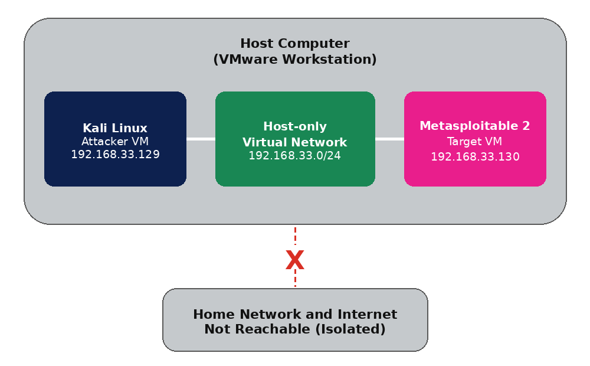
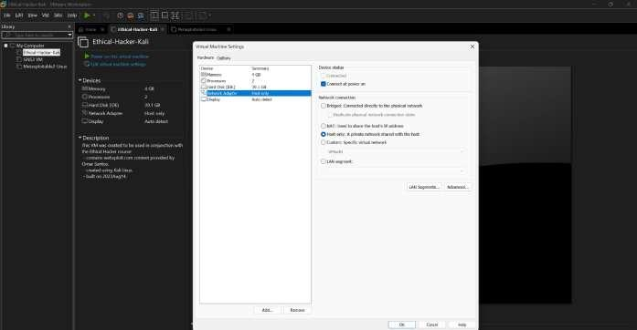
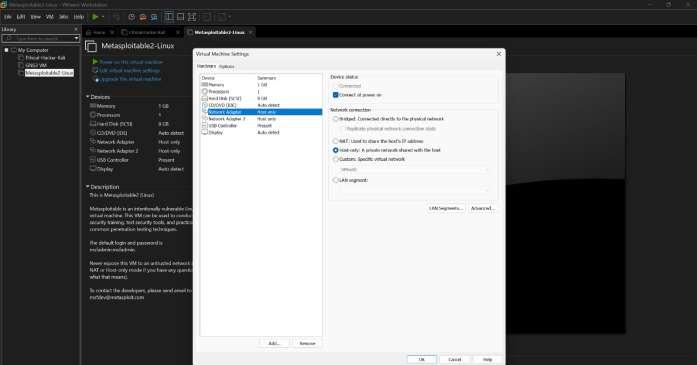
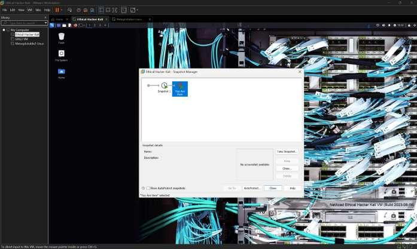
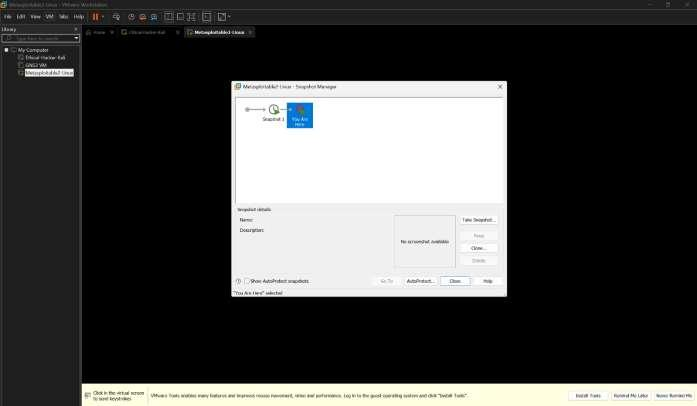
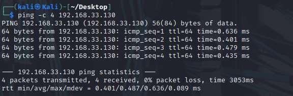
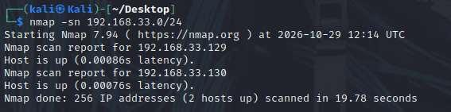
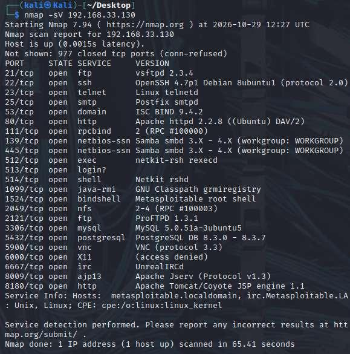

# Isolated Virtual Lab Setup and Network Reconnaissance

## 1. Objective

The objective of this project was to build and verify a private, isolated virtualised cybersecurity lab in **VMware Workstation** and perform structured network reconnaissance against an authorised target virtual machine. Configuring an isolated host-only network ensures that deliberately vulnerable target systems cannot reach—or be reached from—the host's local network or the public internet while allowing safe practice of host discovery, connectivity verification, and service version enumeration.

---

## 2. Environment and Tools Used

* **Hypervisor:** VMware Workstation
* **Network Topology:** Isolated Host-Only Virtual Network (`192.168.33.0/24`) — no Bridged or NAT internet connectivity
* **Attacker / Analysis VM (`Ethical-Hacker-Kali`):**
  * **Image:** NetAcad Ethical Hacker Kali VM (Build 2023-08-14)
  * **Hardware Allocation:** 4 GB RAM, 2 vCPUs, 30.1 GB Virtual Disk
  * **Network Interface:** Host-only (`192.168.33.129`)
* **Target VM (`Metasploitable2-Linux`):**
  * **Image:** Metasploitable 2 (intentionally vulnerable Linux training VM)
  * **Hardware Allocation:** 1 GB RAM, 1 vCPU, 8 GB Virtual Disk
  * **Network Interfaces:** Host-only (`192.168.33.130`)
* **Tools & Utilities:** VMware Virtual Machine Settings, VMware Snapshot Manager, `ping`, and **Nmap `v7.94`** (`nmap -sn`, `nmap -sV`)

---

## 3. Step-by-Step Method

1. **Configure Host-Only Network Isolation:**
   * Powered off both virtual machines before modifying virtual hardware settings.
   * Opened **Virtual Machine Settings > Hardware > Network Adapter** for both `Ethical-Hacker-Kali` and `Metasploitable2-Linux` and set the network connection to **Host-only: A private network shared with the host** (`192.168.33.0/24`), avoiding Bridged or NAT modes so the vulnerable target remains strictly isolated.
2. **Capture Clean Baseline Snapshots:**
   * Created `Snapshot 1` on both `Ethical-Hacker-Kali` and `Metasploitable2-Linux` using VMware **Snapshot Manager** so either VM can be reverted to a known-good baseline state if misconfigurations occur.
3. **Verify IP Addressing & Bidirectional Connectivity:**
   * Confirmed each guest VM received an IP address on the `192.168.33.0/24` subnet (`192.168.33.129` for Kali and `192.168.33.130` for Metasploitable 2).
   * Sent four ICMP echo requests from Kali to the target to verify Layer 3 reachability:
     ```bash
     ping -c 4 192.168.33.130
     ```
4. **Perform Subnet Host Discovery (`nmap -sn`):**
   * Conducted a ping sweep across the entire host-only `/24` subnet without port scanning to identify active hosts:
     ```bash
     nmap -sn 192.168.33.0/24
     ```
5. **Enumerate Open Ports & Service Versions (`nmap -sV`):**
   * Fingerprinted open TCP ports, running services, and software versions on the target VM (without performing any exploitation):
     ```bash
     nmap -sV 192.168.33.130
     ```

---

## 4. Results and Evidence

### Lab Connectivity & Discovery Summary

| Parameter | Verified Value |
| :--- | :--- |
| **Kali Linux (Attacker) IP** | `192.168.33.129` |
| **Metasploitable 2 (Target) IP** | `192.168.33.130` |
| **Host-Only Subnet** | `192.168.33.0/24` |
| **ICMP Ping Verification** | 4 transmitted, 4 received, 0% packet loss (`0.487 ms` avg RTT) |
| **Live Hosts Discovered (`-sn`)** | 2 hosts (`192.168.33.129` and `192.168.33.130`) |
| **Open TCP Ports Identified (`-sV`)** | 23 open TCP ports (977 closed ports) |

### Enumerated Services on Target (`192.168.33.130`)

| Port | Protocol | Service | Detected Version (`nmap -sV`) | Risk Assessment |
| :--- | :--- | :--- | :--- | :--- |
| `21` | tcp | `ftp` | `vsftpd 2.3.4` | High — Contains known backdoor vulnerability |
| `22` | tcp | `ssh` | `OpenSSH 4.7p1 Debian 8ubuntu1 (protocol 2.0)` | High — Outdated SSH daemon |
| `23` | tcp | `telnet` | `Linux telnetd` | High — Unencrypted remote login protocol |
| `25` | tcp | `smtp` | `Postfix smtpd` | Medium — Exposed mail transfer agent |
| `53` | tcp | `domain` | `ISC BIND 9.4.2` | High — Outdated DNS server version |
| `80` | tcp | `http` | `Apache httpd 2.2.8 ((Ubuntu) DAV/2)` | High — End-of-life web server with WebDAV |
| `111` | tcp | `rpcbind` | `2 (RPC #100000)` | Medium — Exposes RPC service mappings |
| `139` | tcp | `netbios-ssn` | `Samba smbd 3.X - 4.X (workgroup: WORKGROUP)` | High — Outdated SMB/NetBIOS file sharing |
| `445` | tcp | `netbios-ssn` | `Samba smbd 3.X - 4.X (workgroup: WORKGROUP)` | High — Outdated SMB daemon susceptible to RCE |
| `512` | tcp | `exec` | `netkit-rsh rexecd` | High — Legacy unencrypted remote execution |
| `513` | tcp | `login?` | `(not identified)` | High — Legacy `rlogin` remote access service |
| `514` | tcp | `shell` | `Netkit rshd` | High — Legacy unencrypted remote shell |
| `1099` | tcp | `java-rmi` | `GNU Classpath grmiregistry` | High — Exposed Java RMI registry |
| `1524` | tcp | `bindshell` | `Metasploitable root shell` | Critical — Unauthenticated root shell listener |
| `2049` | tcp | `nfs` | `2-4 (RPC #100003)` | High — Network File System export exposure |
| `2121` | tcp | `ftp` | `ProFTPD 1.3.1` | High — Outdated FTP server |
| `3306` | tcp | `mysql` | `MySQL 5.0.51a-3ubuntu5` | High — Network-exposed legacy database |
| `5432` | tcp | `postgresql` | `PostgreSQL DB 8.3.0 - 8.3.7` | High — Network-exposed legacy database |
| `5900` | tcp | `vnc` | `VNC (protocol 3.3)` | High — Remote desktop service exposed |
| `6000` | tcp | `X11` | `(access denied)` | Medium — Exposed X Window System port |
| `6667` | tcp | `irc` | `UnrealIRCd` | High — Legacy IRC daemon with known backdoor |
| `8009` | tcp | `ajp13` | `Apache Jserv (Protocol v1.3)` | High — Exposed AJP connector |
| `8180` | tcp | `http` | `Apache Tomcat/Coyote JSP engine 1.1` | High — Outdated Tomcat management/web interface |

### Key Security Observations

* **Backdoored FTP Service (`21/tcp` — `vsftpd 2.3.4`):** This specific legacy release contains a well-known malicious backdoor that allows an unauthenticated attacker reaching port 21 to trigger a remote root command shell.
* **Outdated SMB File Sharing (`139/tcp` & `445/tcp` — `Samba smbd 3.X - 4.X`):** Exposing outdated Samba services over the network allows attackers to exploit known remote code execution flaws to read, modify, or delete shared files and pivot across the subnet.
* **Unauthenticated Root Bindshell & Cleartext Protocols (`1524/tcp`, `23/tcp`, `512–514/tcp`):** Port `1524` provides direct root shell access without authentication, while Telnet and Berkeley `r`-services transmit credentials and commands in plaintext.

### Supporting Evidence

All screenshots and logs below have been sanitised to exclude personal identifiers, student numbers, and host-machine details:

* **Sanitised Scan Output Log:** [`evidence/nmap-recon-output.txt`](./evidence/nmap-recon-output.txt)
* **Lab Network Topology Diagram:**
  
* **VMware Network Isolation Settings (Kali & Metasploitable 2):**
  
  
* **Clean Baseline Snapshots (Kali & Metasploitable 2):**
  
  
* **Connectivity Verification & Nmap Reconnaissance Outputs:**
  
  
  

---

## 5. Remediation and What I Would Do Differently

### How to Fix the Issues Found

1. **Decommission Backdoored and Cleartext Services:** Immediately terminate the unauthenticated root bindshell (`1524/tcp`), disable legacy plaintext protocols (`telnet` on `23/tcp` and `rexec`/`rlogin`/`rsh` on `512–514/tcp`), and replace `vsftpd 2.3.4` and `ProFTPD 1.3.1` with SFTP over an updated SSH daemon.
2. **Apply Security Patches and Upgrade Legacy Daemons:** Upgrade OpenSSH (`4.7p1`), Apache HTTP (`2.2.8`), Apache Tomcat, Samba (`3.X–4.X`), MySQL (`5.0.51a`), and PostgreSQL (`8.3.x`) to actively supported releases.
3. **Implement Host-Based Firewalling & Least-Privilege Access:** Configure `ufw` or `iptables` on the server to deny all inbound traffic by default, permit only explicitly required services, bind databases (`3306`, `5432`) to `127.0.0.1` instead of external interfaces, and suppress verbose version banners.

### What I Would Do Differently

* **Scan the Full Port Range and UDP Services:** In this exercise, `nmap -sV` scanned Nmap's default top 1,000 TCP ports. Next time, I would run a full 65,535-port TCP scan (`nmap -p-`) alongside a targeted UDP scan (`nmap -sU --top-ports 50`) to ensure non-standard or UDP-based services (such as SNMP or TFTP) are not overlooked.
* **Capture Packet-Level Telemetry & Structured Output:** I would save Nmap results directly in all standard formats (`-oA evidence/recon-scan`) and capture traffic simultaneously in Wireshark to observe how ping sweeps and TCP service probes appear on the wire.
